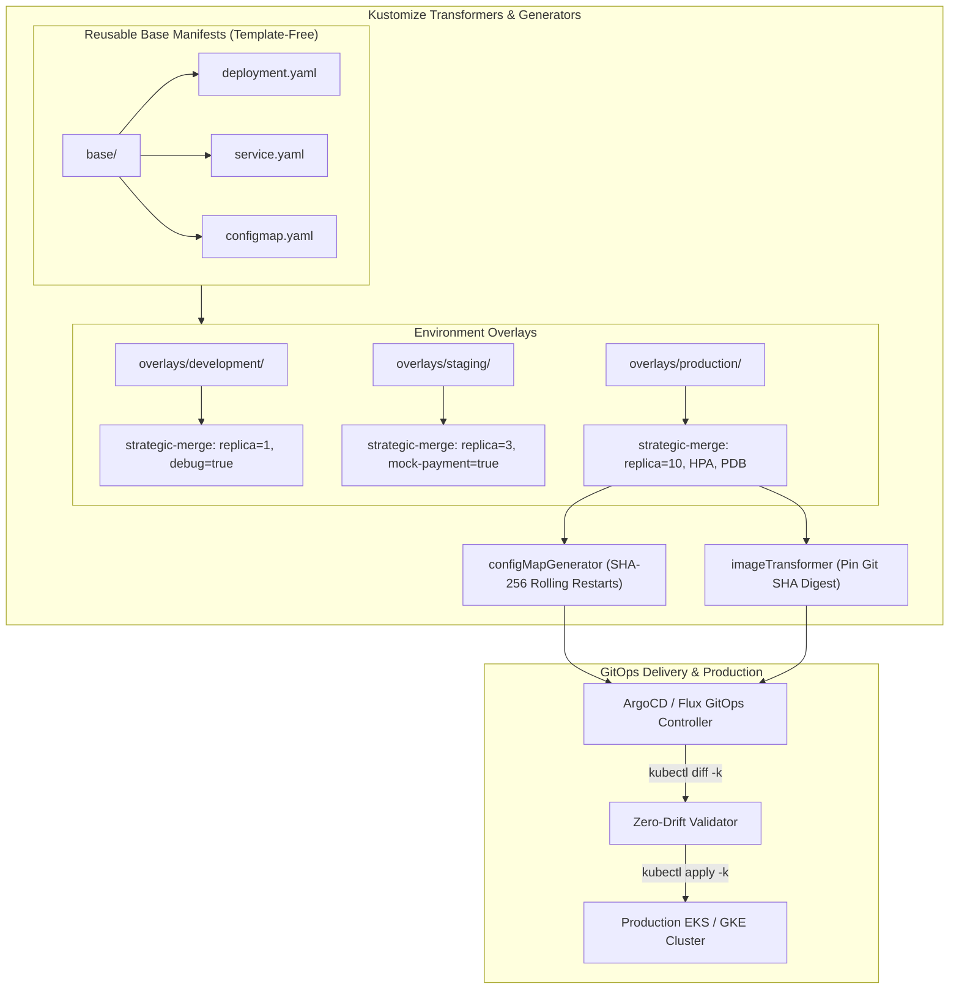

# Kustomize Declarative Kubernetes Overlays Platform (`tp-kustomize`)

[](https://slsa.dev)
[](https://talaripradeep.info)
[](LICENSE)
[](https://github.com/Pradeeptalari14/tp-kustomize/actions)

> **Production Repository:** [`Pradeeptalari14/tp-kustomize`](https://github.com/Pradeeptalari14/tp-kustomize)  
> **Interactive Studio Workspace:** [https://talaripradeep.info/tools/kustomize/](https://talaripradeep.info/tools/kustomize/)  
> **Visual Flow Canvas:** [https://talaripradeep.info/studios/flow/?studio=kustomize](https://talaripradeep.info/studios/flow/?studio=kustomize)  
> **Architecture Center:** [https://talaripradeep.info/architecture/](https://talaripradeep.info/architecture/)

---

## 🏛️ Production Architecture Flow



---

## 🛡️ Core Engineering & 9+ DevSecOps / SRE Governance Principles

This platform implements the **9+ enterprise DevSecOps and SRE governance principles**, ensuring audited supply-chain security, zero-drift declarative state, and automated resilience:

| Governance Pillar | Implementation in Kustomize Platform | Production Guarantee |
|---|---|---|
| **1. Cosign SLSA L3** | Enforce immutable, digest-pinned image transformers (`image:tag@sha256:...`) | Guarantees deployments only pull verified, signed container artifacts |
| **2. Semgrep AST** | Scan compiled Kustomize outputs with AST rules for privilege escalation | Blocks containers requesting root, hostPID, or hostNetwork privileges |
| **3. CycloneDX SBOM** | Continuous verification that manifests adhere to zero-CVE image policies | Integrates SBOM checks into the pre-deployment CI validation phase |
| **4. Kyverno Admission** | Kyverno CLI pre-commit policy enforcement on overlay output | Fails pull requests if manifests violate organization governance rules |
| **5. eBPF Tetragon** | Validate that newly applied overlays do not trigger unexpected syscall alarms | Ensures runtime process execution matches declarative security intent |
| **6. GitOps Zero-Drift** | Exact declarative state declared in Git; verified via `kubectl diff -k` | Eliminates configuration drift between staging and production |
| **7. MELT Signals** | Annotate Kubernetes Deployments with Prometheus scraping and OTel exporter hints | Automated discovery and metrics scraping upon manifest deployment |
| **8. Automated SRE Repair** | Automated rolling deployments triggered by `configMapGenerator` hash changes | Prevents silent configuration drift where pods run stale settings |
| **9. Zero-Trust Access** | Restrict namespace boundaries and RBAC permissions in environment overlays | Enforces strict isolation between development, staging, and production |

---

## 💻 Infrastructure & Software Technology Stack

| Architectural Layer | Technology & Tools | Production Role |
|---|---|---|
| **Configuration Engine** | Kustomize v5.3+ (Built-in to `kubectl -k`) | Declarative, template-free manifest composition and overlay patching |
| **Continuous Delivery** | ArgoCD, Flux CD | Automated GitOps controller reconciling overlays with production state |
| **Policy & Validation** | Kyverno CLI, kube-score, Semgrep AST | Pre-commit static validation and compliance verification of compiled YAML |
| **Image Governance** | Sigstore Cosign, Docker Buildx | Cryptographic image digest pinning across environment overlays |
| **Version Control** | Git, GitHub Actions CI | Traceable change history with mandatory code reviews and branch protection |
| **Deployment Target** | Kubernetes v1.28+ (EKS, GKE, AKS, Bare-Metal) | Production container orchestration executing declarative manifest state |

---

## 🎯 Where to Use (Real-World Production Scenarios)

### 1. Multi-Environment Application Lifecycle (Dev -> Staging -> Prod)
Maintain a single source of truth in `base/` while overriding replicas, resource requests, and environment variables declaratively in `overlays/` without duplicating YAML files.

### 2. Zero-Downtime Rolling Restarts via Content-Hash Generation
Use `configMapGenerator` to append a SHA-256 hash of configuration contents to the ConfigMap name, ensuring pods automatically trigger a rolling update whenever settings change.

### 3. Multi-Region SaaS Ingress & Database Configuration
Tailor regional microservice settings (e.g. EU vs US data residency endpoints) cleanly using JSON 6902 patches without maintaining fragile Helm templates.

---

## 📋 Step-by-Step SRE Deployment & Verification Runbook

### Phase 1: Kustomize Overlay Compilation & Static Audit
```bash
# 1. Build and compile production overlay
kustomize build overlays/production > /tmp/compiled-prod.yaml

# 2. Run Kyverno pre-commit policy check
kyverno apply /etc/kyverno/policies --resource /tmp/compiled-prod.yaml

# 3. Verify zero-drift against live production cluster
kubectl diff -k overlays/production
```

### Phase 2: Deployment & Health Verification
```bash
# 1. Apply declarative production overlay
kubectl apply -k overlays/production

# 2. Track rolling update progress
kubectl rollout status deployment/prod-app-backend -n production

# 3. Verify ConfigMap hash and active pod configuration
kubectl get configmaps -n production
kubectl get pods -n production -l tier=backend
```

### Phase 3: SRE Triage & Failure Remediation Matrix
| Incident Symptom | Underlying Root Cause | Rapid SRE Remediation Command |
|---|---|---|
| **Patch Target Not Found** | Group/Version/Kind mismatch in `patchesStrategicMerge` | Verify `apiVersion` and `kind` in patch file exactly match base |
| **Pod CrashLoop after Config Change** | Invalid syntax or missing environment variable in ConfigMap | Revert Git commit on `kustomization.yaml` and trigger immediate GitOps sync |
| **Stale Configuration in Running Pod** | ConfigMap mounted as volume without restart mechanism | Switch to `configMapGenerator` to trigger automatic hash-based rolling restarts |
| **GitOps Drift Alert Triggered** | Manual `kubectl edit` executed directly on production cluster | Run `kubectl diff -k overlays/production` & reconcile from Git state |

---

## 🚀 Quickstart & Verification Drill

```bash
# 1. Clone repository
git clone https://github.com/Pradeeptalari14/tp-kustomize.git
cd tp-kustomize

# 2. Run automated validation script
chmod +x scripts/validate.sh
./scripts/validate.sh
```

---

## 📄 License & Security Policy

- **License**: [MIT License](LICENSE) — Copyright (c) 2026 Talari Pradeep. All rights reserved.
- **Security Policy**: See [SECURITY.md](SECURITY.md) for vulnerability disclosure and triage workflows.

---
*Synchronized with [Talari Pradeep Developer Studios](https://talaripradeep.info/studios/) & [Repository Learning DAG](https://talaripradeep.info/tools/repo-learning/)*
